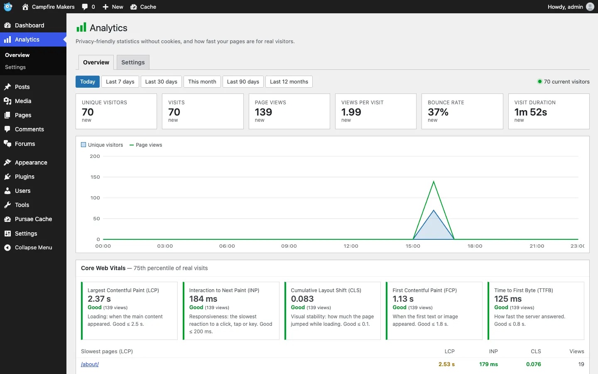
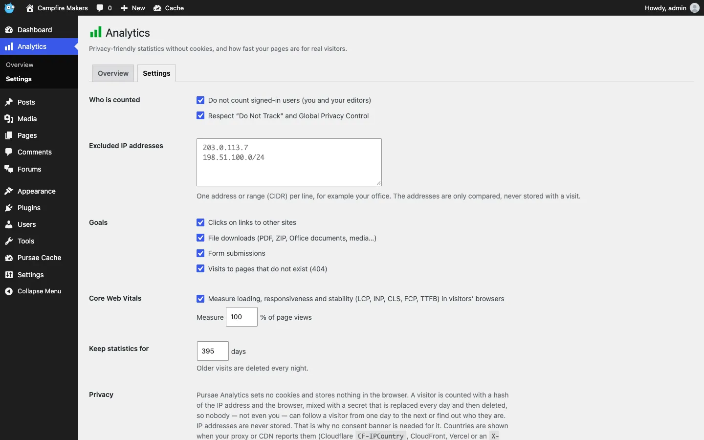
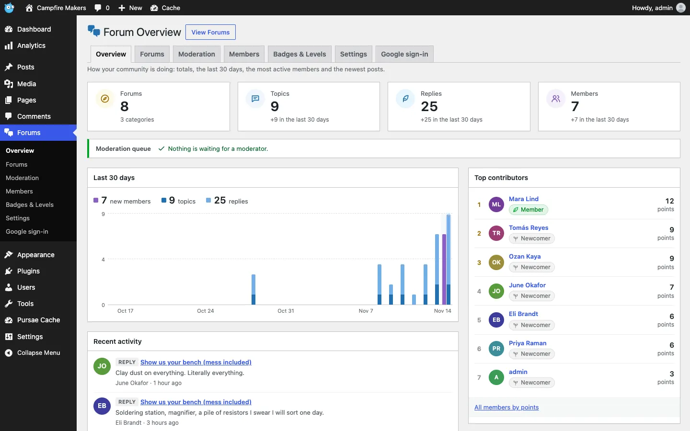
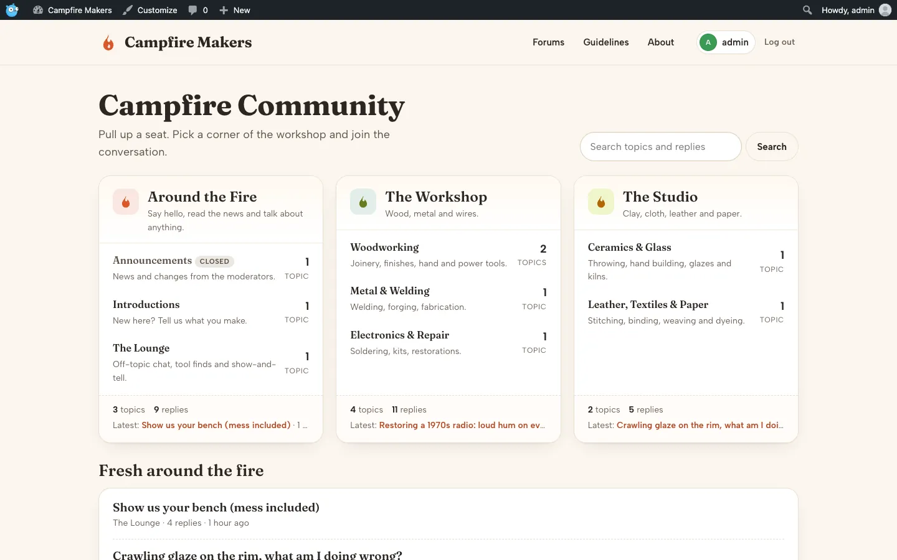
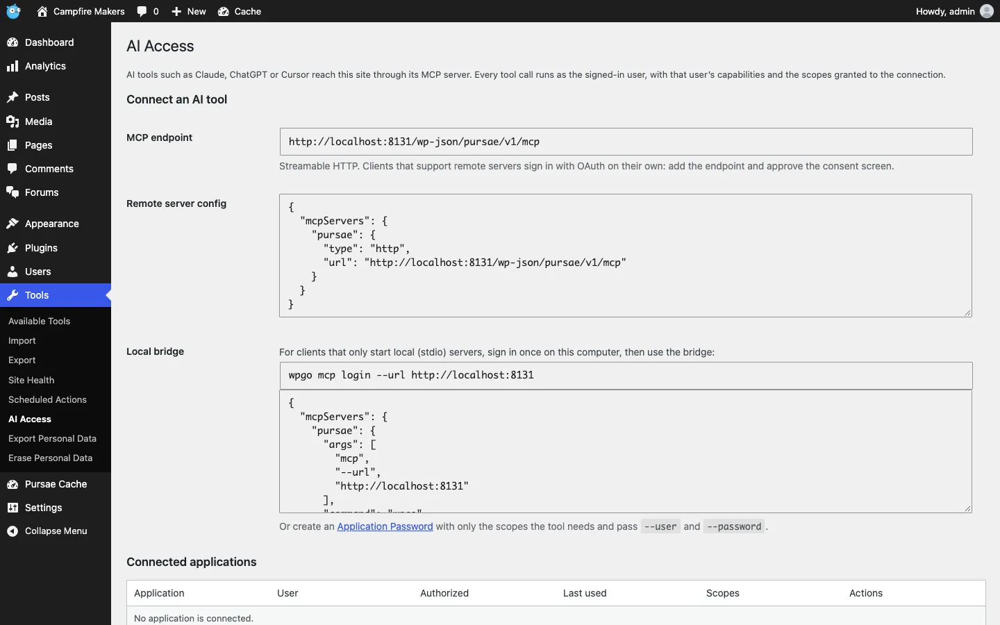

<p align="center">
  
</p>

<h1 align="center">Pursae</h1>

<p align="center"><b>WordPress, rewritten in Go.</b><br>
One binary · PostgreSQL · the admin you already know · 18 built-in plugins.</p>

<p align="center">
  
  
  
  
  
</p>

<p align="center">
  <a href="#-quick-start">Quick start</a> ·
  <a href="#-tour">Tour</a> ·
  <a href="#-built-in-plugins">Plugins</a> ·
  <a href="#-ai-agents-mcp">AI agents</a> ·
  <a href="#-what-pursae-sends-to-hubpursaecom">Privacy</a> ·
  <a href="docs/GUIDE.md">Full guide</a> ·
  <a href="docs/developer/README.md">Developer docs</a>
</p>

<p align="center">
  
</p>

## ⚡ Quick start

You need Docker (with Compose v2), git and make.

**On a server** (production build, updates from hub.pursae.com, behind your TLS proxy):

```sh
git clone https://github.com/pursae/pursae.git && cd pursae
cp docker/.env.example docker/.env    # set WPGO_DB_PASSWORD, WPGO_SITE_URL (https://…), SMTP
make prod-up                          # → 127.0.0.1:8088; point Caddy or nginx at it
```

Open your `https://` address right away and finish the installer: until then anyone who reaches the
site can run it. Updates arrive in **Dashboard › Updates** (one click); data lives in Docker volumes.

**On your machine** (development build to try it out; it does not talk to hub.pursae.com):

```sh
make docker-up                        # → http://localhost:8088
```

Ports, env vars, proxies, backups: **[docs/GUIDE.md](docs/GUIDE.md)**.

## ✨ Why Pursae

<table>
<tr>
<td width="25%" align="center"><h3>🐹</h3><b>One Go binary</b><br><sub>No PHP, no FPM, no extensions.</sub></td>
<td width="25%" align="center"><h3>🐘</h3><b>PostgreSQL 17</b><br><sub>Typed schema, JSONB, migrations on start.</sub></td>
<td width="25%" align="center"><h3>🧩</h3><b>Wasm plugins</b><br><sub>Signed, sandboxed, permission-gated.</sub></td>
<td width="25%" align="center"><h3>🚀</h3><b>Fast by default</b><br><sub>Built-in page cache, static builder output.</sub></td>
</tr>
</table>

## 🧭 Tour

<table>
<tr>
<td width="50%"><p align="center"><b>Dashboard</b> — the WordPress admin, 1:1</p></td>
<td width="50%"><p align="center"><b>Pursae Editor</b> — the real block editor</p></td>
</tr>
<tr>
<td><p align="center"><b>Pursae Web Builder</b> — visual pages, static output</p></td>
<td><p align="center"><b>Twenty Twenty-Five</b> — demo content in one click</p></td>
</tr>
</table>

<details>
<summary><b>📸 More core screens</b> — posts, media, themes, menus, plugins, users, health, settings</summary>
<br>
<table>
<tr>
<td width="50%"><p align="center">Posts</p></td>
<td width="50%"><p align="center">Media Library</p></td>
</tr>
<tr>
<td><p align="center">Themes</p></td>
<td><p align="center">Menus</p></td>
</tr>
<tr>
<td><p align="center">Plugins</p></td>
<td><p align="center">Users &amp; multi-role</p></td>
</tr>
<tr>
<td><p align="center">Site Health</p></td>
<td><p align="center">Settings</p></td>
</tr>
</table>
</details>

## 🧩 Built-in plugins

Native, switched on and off with one click under **Plugins**; all of them are off on a fresh install
except Pursae Cache and Classic Editor. Click a heading below the table to open its screenshots.

| | Plugin | In one line | Docs |
|---|---|---|---|
| 🛒 | **Pursae Commerce** | Store, cart, checkout, orders, premium modules | [→](docs/goocommerce-features.md) |
| 🎨 | **Pursae Web Builder** | Visual pages, Theme Builder, popups, theme library | [→](docs/developer/web-builder.md) |
| 🔎 | **Pursae SEO** | Analysis, schema, sitemaps, redirects | [→](docs/seo-go-features.md) |
| ⚡ | **Pursae Cache** | Full-page cache + page optimization | [→](docs/developer/operations/caching.md) |
| 🛡️ | **Pursae Security** | 2FA, MFA codes, lockouts, activity log | [→](docs/adminsecgo-features.md) |
| ☁️ | **Pursae CDN** | S3/R2 offload, image service, purge | [→](docs/gocdn-features.md) |
| 🔌 | **Pursae Headless** | Content types, REST, GraphQL, webhooks | [→](docs/headlessgo-features.md) |
| 🍪 | **Pursae Cookie** | GDPR/KVKK banner, Consent Mode v2 | [→](docs/gooike-features.md) |
| 📈 | **Pursae Pixel** | Meta, GA4, Ads, TikTok + server-side | [→](docs/pixelgo-features.md) |
| 📊 | **Pursae Analytics** | Cookieless stats + real-user Core Web Vitals | [→](docs/analytics-features.md) |
| 💬 | **Pursae Forum** | Forums, email + Google sign-up, levels & badges | [→](docs/forum-features.md) |
| ✉️ | **Pursae SMTP** | Mailers, email log, reports | [→](docs/wpgo-mail-smtp-features.md) |
| 🗂️ | **Pursae Custom Fields** | Field groups, CPTs, options pages | [→](docs/acf-go-features.md) |
| 🌍 | **Pursae Multi Language** | Languages, translations, hreflang | [→](docs/golylang-features.md) |
| 📝 | **Pursae Contact Form** | Forms, mail templates, spam guard | [→](docs/gontact-form-features.md) |
| 🚧 | **Pursae Maintenance** | Maintenance / coming-soon page | [→](docs/maintenance-go-features.md) |
| 💾 | **Pursae Backup Manager** | One-click backup &amp; migrate | [→](docs/backup-manager-features.md) |
| 📄 | **Classic Editor** | TinyMCE editing, per-user switch | — |

<details>
<summary><h3>🛒 Pursae Commerce</h3></summary>
<table><tr>
<td width="50%"><p align="center">Store themes with a full demo shop</p></td>
<td width="50%"><p align="center">Premium modules, built in</p></td>
</tr><tr>
<td><p align="center">Home &amp; setup tasks</p></td>
<td><p align="center">Analytics</p></td>
</tr></table>
<p align="right"><a href="docs/goocommerce-features.md">All features →</a></p>
</details>

<details>
<summary><h3>🎨 Pursae Web Builder</h3></summary>
<table><tr>
<td width="50%"><p align="center">Sections, design, devices</p></td>
<td width="50%"><p align="center">Theme Builder: header, footer, templates</p></td>
</tr></table>
<p align="right"><a href="docs/developer/web-builder.md">All features →</a> · <a href="docs/developer/web-builder-theme-builder.md">Theme Builder →</a> · <a href="docs/developer/web-builder-theme-library.md">Theme library →</a></p>
</details>

<details>
<summary><h3>🔎 Pursae SEO</h3></summary>
<table><tr>
<td width="50%"><p align="center">Scores &amp; modules</p></td>
<td width="50%"><p align="center">Titles &amp; meta</p></td>
</tr></table>
<p align="right"><a href="docs/seo-go-features.md">All features →</a></p>
</details>

<details>
<summary><h3>⚡ Pursae Cache</h3></summary>
<table><tr>
<td width="50%"><p align="center">Dashboard &amp; purges</p></td>
<td width="50%"><p align="center">Page optimization</p></td>
</tr></table>
<p align="right"><a href="docs/developer/operations/caching.md">All features →</a></p>
</details>

<details>
<summary><h3>🛡️ Pursae Security</h3></summary>
<table><tr>
<td width="50%"><p align="center">Security score &amp; checklist</p></td>
<td width="50%"><p align="center">2FA per role</p></td>
</tr></table>
<p align="right"><a href="docs/adminsecgo-features.md">All features →</a></p>
</details>

<details>
<summary><h3>☁️ Pursae CDN</h3></summary>
<table><tr>
<td width="50%"><p align="center">S3-compatible storage</p></td>
<td width="50%"><p align="center">On-the-fly WebP image service</p></td>
</tr></table>
<p align="right"><a href="docs/gocdn-features.md">All features →</a></p>
</details>

<details>
<summary><h3>🔌 Pursae Headless</h3></summary>
<table><tr>
<td width="50%"><p align="center">Content-Type Builder</p></td>
<td width="50%"><p align="center">GraphQL playground</p></td>
</tr></table>
<p align="right"><a href="docs/headlessgo-features.md">All features →</a></p>
</details>

<details>
<summary><h3>🍪 Pursae Cookie</h3></summary>
<table><tr>
<td width="50%"><p align="center">14 banner themes</p></td>
<td width="50%"><p align="center">Consent dashboard</p></td>
</tr></table>
<p align="right"><a href="docs/gooike-features.md">All features →</a></p>
</details>

<details>
<summary><h3>📈 Pursae Pixel</h3></summary>
<table><tr>
<td width="50%"><p align="center">All platforms at a glance</p></td>
<td width="50%"><p align="center">Pixels &amp; Conversions APIs</p></td>
</tr></table>
<p align="right"><a href="docs/pixelgo-features.md">All features →</a></p>
</details>

<details>
<summary><h3>📊 Pursae Analytics</h3></summary>
<table><tr>
<td width="50%"><p align="center">Visitors, views and Core Web Vitals</p></td>
<td width="50%"><p align="center">Who is counted, goals, retention</p></td>
</tr></table>

Privacy-friendly site statistics on one page (**Analytics** in the admin menu), without cookies, without
storing IP addresses and without a consent banner — in the class of Plausible and Jetpack Stats:

- **Visitors, visits, page views**, views per visit, bounce rate and visit duration, each compared with the previous period, a chart and live visitors.
- **Top and entry pages, sources** (Google, ChatGPT, social networks, other sites), **UTM campaigns**, countries, devices, browsers and operating systems.
- **Goals**: outbound link clicks, file downloads, form submissions and 404s.
- **Real-user Core Web Vitals**: LCP, INP, CLS, FCP and TTFB at the 75th percentile, site-wide and for the slowest pages.
- A 2.3 KB script (1.2 KB gzipped) that works behind the page cache; visitors are counted with a daily salted hash that cannot be followed across days. JSON summary at `GET /pursae/v1/analytics`.

<p align="right"><a href="docs/analytics-features.md">All features →</a></p>
</details>

<details>
<summary><h3>💬 Pursae Forum</h3></summary>
<table><tr>
<td width="50%"><p align="center">Overview, moderation, members, badges</p></td>
<td width="50%"><p align="center">Campfire theme with its demo content</p></td>
</tr></table>

A bbPress-class discussion board that renders inside any theme (**Forums** in the admin menu):

- **Categories, forums, topics and replies**, pinned and closed topics, search, profiles and a member list — all plain forms, no JavaScript.
- **Membership on the front end**: email sign-up with confirmation, "Continue with Google" (OAuth with PKCE), an account page with profile photos.
- **Levels and badges**: points for topics and replies, six default levels, rule-based and hand-awarded badges with icons or images.
- **Moderation**: approve, pin, close, spam, trash and block from the post itself or the admin queue; first-post moderation, flood and hourly limits.
- **Themes**: four forum themes with demo content (Campfire, Devboard, Guild Hall, Study Circle), `--pf-*` design tokens and per-view template overrides; works with Pursae Web Builder and Pursae Multi Language. Read-only REST at `/wp-json/forum/v1`.

<p align="right"><a href="docs/forum-features.md">All features →</a> · <a href="docs/developer/themes/forum.md">Making a forum theme →</a></p>
</details>

<details>
<summary><h3>✉️ Pursae SMTP</h3></summary>
<table><tr>
<td width="50%"><p align="center">Pick a mailer</p></td>
<td width="50%"><p align="center">Email reports</p></td>
</tr></table>
<p align="right"><a href="docs/wpgo-mail-smtp-features.md">All features →</a></p>
</details>

<details>
<summary><h3>🗂️ Custom Fields · 🌍 Multi Language · 📝 Contact Form</h3></summary>
<table><tr>
<td width="33%"><p align="center"><a href="docs/acf-go-features.md">Custom Fields →</a></p></td>
<td width="33%"><p align="center"><a href="docs/golylang-features.md">Multi Language →</a></p></td>
<td width="33%"><p align="center"><a href="docs/gontact-form-features.md">Contact Form →</a></p></td>
</tr></table>
</details>

<details>
<summary><h3>🚧 Maintenance · 💾 Backup Manager</h3></summary>
<table><tr>
<td width="50%"><p align="center"><a href="docs/maintenance-go-features.md">Maintenance →</a></p></td>
<td width="50%"><p align="center"><a href="docs/backup-manager-features.md">Backup Manager →</a></p></td>
</tr></table>
</details>

## 🤖 AI agents (MCP)

<table><tr>
<td width="50%"><p align="center"><b>Tools › AI Access</b> — endpoint, client configs, connected apps, activity log</p></td>
<td width="50%">

A built-in [Model Context Protocol](https://modelcontextprotocol.io) server at `/wp-json/pursae/v1/mcp`
lets Claude, Cursor and other MCP clients run the site:

- Posts, pages, media, terms, menus, comments, users, themes and theme files, plugins, updates,
  backups, Pursae Cache, SEO, Commerce, Headless and the built-in plugins' settings.
- Sign-in with **OAuth 2.1** (a consent screen in the browser) or an **Application Password** with
  scopes; every tool runs as a REST request with the same capabilities.
- `wpgo mcp` bridges clients that only start local (stdio) servers.
- Every write is logged for 90 days; revoke a client under Users › Profile.

<a href="docs/developer/operations/ai-mcp.md">AI agents (MCP) →</a>

</td>
</tr></table>

## 🔁 WordPress compatibility

- **Admin**: the WordPress admin markup and CSS 1:1 under `/wp-admin/` (old `.php` URLs still work).
- **Editors**: the real block editor (`@wordpress/*` bundles) and a built-in Classic Editor.
- **REST API**: `wp/v2` with cookie + nonce and Application Passwords; `wc/v3` with Commerce on — [REST docs](docs/developer/rest-api/index.md).
- **Content**: WXR import and export under Tools; WooCommerce's product CSV under Products.
- **Not supported**: PHP plugins and PHP themes (themes are Go templates with a [`theme.json` manifest](docs/developer/themes/theme-json.md)) and multisite.

## 🐹 Go architecture

- One static binary (`CGO_ENABLED=0`) with the admin, the editors and the bundled themes embedded.
- [gin](https://github.com/gin-gonic/gin) for HTTP, [pgx](https://github.com/jackc/pgx) on PostgreSQL 17 (14+ works); migrations run on start.
- Plugins run as WebAssembly in [wazero](https://wazero.io) — no cgo, no separate runtime.
- Details: [What is Pursae](docs/developer/getting-started/index.md) · [binary install](docs/developer/getting-started/install-binary.md).

## 🧩 The WordPress ecosystem without PHP

- **Plugins** are Go compiled to signed Wasm, sandboxed and permission-gated — [plugin docs](docs/developer/plugins/index.md), [signing](docs/developer/plugins/packaging-and-signing.md).
- **Built in**: Commerce, Web Builder, SEO, Cache, Security, CDN, Headless, Cookie, Pixel, Analytics, Forum, SMTP, Custom Fields, Multi Language, Contact Form, Maintenance, Backup Manager, Classic Editor ([table below](#-built-in-plugins); [what each replaces](docs/developer/benchmarks.md#whats-built-in)).
- **Themes** are zip packages of templates and assets with no code in them — [theme packages](docs/theme-package.md); a marketplace of both on the [Hub](docs/developer/hub/index.md).

## 📊 Performance benchmarks

Same content (1000 posts, 200 products), Twenty Twenty-Five, same container limits; WordPress 7.1.4 + PHP 8.3 OPcache
against Pursae 0.1.9, Apple M2 Pro under Docker, 2026-11-09:

| | WordPress | Pursae |
|---|---:|---:|
| Single post, no page cache | 58 req/s | **394 req/s** |
| Single post with the usual plugins (Woo, Yoast, Polylang, ACF, Elementor, CF7 vs built-ins) | 19 req/s | **232 req/s** |
| DB queries, home page with those plugins | 139 | **16** |
| Memory idle, whole stack | 233 MiB | **95 MiB** |

Cached pages tie (WP Super Cache + nginx ≈ Pursae Cache), cold start is the same, and WordPress' page cache serves
search while Pursae's does not. Method, every config, all tables and `make bench`: [benchmarks](docs/developer/benchmarks.md).

## 🛡️ Security

- Core secure by default: argon2id, login throttling, nonces, CSP and security headers, no account enumeration, sandboxed uploads — [security](docs/developer/operations/security.md).
- Plugins are signed and sandboxed; a site installs only packages whose signature it trusts.
- Multi-role users: capabilities are the union of the roles, with per-user allow and deny — deny wins.
- **Pursae Security** adds 2FA, lockouts, a custom login URL and an activity log — [features](docs/adminsecgo-features.md).

## 📦 Installation & migration

- **Docker** ([Quick start](#-quick-start)) or **one binary** against your own PostgreSQL — [install the binary](docs/developer/getting-started/install-binary.md).
- **From WordPress**: export with Tools › Export (WXR), import with Tools › Import here — posts, pages, terms, comments, menus, and media fetched from their public URLs. Products move with WooCommerce's product CSV.
- Users' passwords, settings, PHP plugins and themes do not move — [content export and import](docs/developer/operations/backups.md#content-export).
- **Pursae to Pursae**: Backup Manager moves a whole site in one archive — [Backup Manager](docs/backup-manager-features.md).

## 🔒 What Pursae sends to hub.pursae.com

Every production build talks to **Pursae Manager at https://hub.pursae.com**. It is how a site gets
updates, the theme and plugin marketplace and licenses. Here is everything it sends, plainly:

| When | What |
|------|------|
| Once a day (and a minute after a core update) | the site's URL, Pursae version, language, OS and CPU architecture, license key (if you entered one), active theme, and the list of installed plugins and themes with their versions, whether they are active, and where they came from (built in, from the Hub, uploaded) |
| As it happens (sent in batches) | what was done with packages: a plugin installed, updated, activated, deactivated or deleted; a theme installed, updated, activated, previewed or deleted; a demo imported; the core updated — each with the slug, version and time |
| On every request to the Hub | the site's URL and license key as headers; the Hub also sees the server's IP address, as any web server does |

The Hub uses this for the numbers you see on it (theme and plugin download and install counts, which
versions sites run) and to decide what a license unlocks. **It never receives your content, users,
e-mail addresses, passwords, visitors, orders or anything else from your database.**

What a site gets back:

- **Updates**: the newest Pursae release, offered under **Dashboard › Updates** and installed with
  one click. Every core binary is signed by the Hub with a key endorsed by the Pursae release key
  built into your binary; the site refuses anything else.
- **Plugins**: Wasm plugins from the marketplace, each signed; by default a site installs only
  packages whose signature it can verify.
- **Themes**: the theme library with demo content, checked against their SHA-256.
- **Licenses** for pro and beta packages, and the product logo.

**Turning it off.** Set `WPGO_HUB=off` in the environment (with Docker: in `docker/.env`) and restart;
the site then sends nothing to hub.pursae.com. **We do not recommend it**: the site gets no update
notices or one-click updates — security fixes included —, no marketplace, no signed plugins and no
licenses, and you have to replace the binary yourself for every release. While it is off, every admin
page says so; remove `WPGO_HUB` and restart to get updates again.

## 🛠️ Build on it

| | |
|---|---|
| 🧩 **Plugins** — Go → signed Wasm, hooks, REST, settings | [docs/developer/plugins](docs/developer/plugins/index.md) |
| 🎨 **Themes** — Go templates + theme.json | [docs/developer/themes](docs/developer/themes/index.md) |
| 💬 **Forum themes** — Pursae Forum wrapper, view overrides, `--pf-*` tokens | [docs/developer/themes/forum.md](docs/developer/themes/forum.md) |
| 🔗 **REST API** — `wp/v2` + plugin routes, Application Password scopes, OAuth 2.1 | [docs/developer/rest-api](docs/developer/rest-api/index.md) |
| 🤖 **AI agents** — MCP server, `wpgo mcp` bridge, tool list | [docs/developer/operations/ai-mcp.md](docs/developer/operations/ai-mcp.md) |
| 🏪 **Hub** — marketplace, updates, licenses | [docs/developer/hub](docs/developer/hub/index.md) |
| ⚙️ **Operations** — config, TLS, backups, cron | [docs/developer/operations](docs/developer/operations/configuration.md) |

## 📚 More

[Full guide](docs/GUIDE.md) (install, configuration, troubleshooting, project layout) ·
[Developer docs](docs/developer/README.md) · [License](LICENSE) · [Notice](NOTICE)

<sub>GPL-2.0-or-later. "WordPress" is a trademark of its owner; Pursae is not affiliated with it.</sub>
